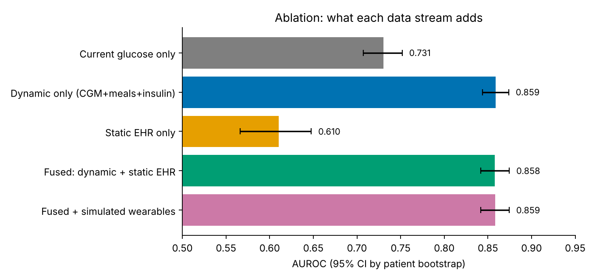
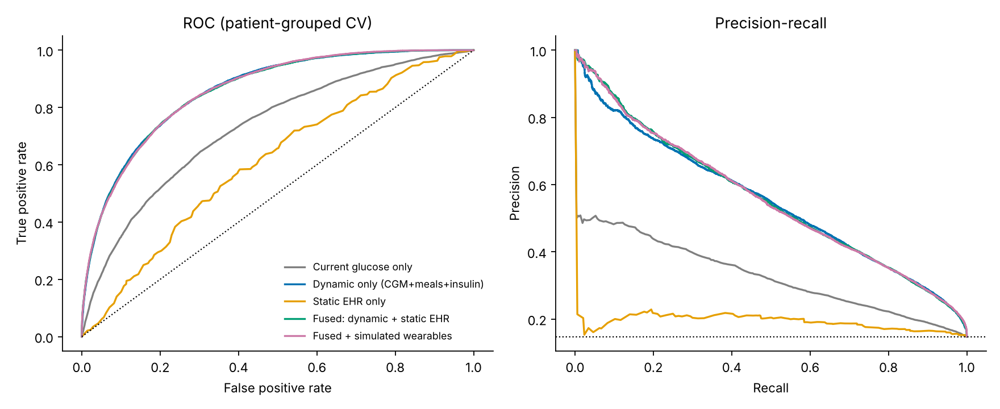

# GlucoTwin: A Digital Twin for 2-Hour Glucose Spike Prediction in Type 2 Diabetes

> Happiest Health "Digital Twin Challenge" - Phase 1 submission

## 1. Team Details (Team INDRA)
| Name | Role | College / Incubator | Email |
|---|---|---|---|
| Muhammed Sahal K B | Team Leader, all roles | Cochin University of Science and Technology (CUSAT), Kochi | msahalkb@gmail.com |

## 2. Project Title
GlucoTwin: A Digital Twin for 2-Hour Glucose Spike Prediction in Type 2 Diabetes

## 3. Problem Statement and Healthcare Use Case
Type 2 diabetes affects over 100 million people in India. Post-meal glucose spikes drive complications, but patients and doctors only see them after they happen. This prototype is a virtual patient that predicts, from the last few hours of data plus the patient's clinical record, whether glucose will rise above 180 mg/dL within the next 2 hours.

## 4. Technical Stack and Model Details
- Python, pandas, scikit-learn, LightGBM, PyTorch, Streamlit
- Static stream: EHR-style clinical features (demographics, HbA1c, C-peptide, eGFR, medications, comorbidities)
- Dynamic stream: CGM every 15 min, logged meals and insulin, simulated heart rate and steps
- Models: LightGBM gradient boosting (main) and an MLP fusion network (comparison)
- Evaluation: patient-grouped cross-validation, AUROC, precision/recall, lead time, ablation (dynamic only / static only / fused)

## 5. Data Sources and Honesty Statement
- Real: Shanghai T2DM dataset (100 patients, CGM, meals, insulin, clinical summary).
- Simulated: heart rate and step count (generated, labelled as such).
- Limitations: East Asian cohort, 3-14 days per patient, simulated wearables, not clinically validated.

## 5b. Results (patient-grouped 5-fold cross-validation, 100 patients, 89,974 windows)
Task: given CGM <= 180 mg/dL now, will glucose exceed 180 mg/dL within the next 2 hours? (14.8% positive)

| Features (LightGBM) | AUROC (95% CI, patient bootstrap) | PR-AUC |
|---|---|---|
| Current glucose only | 0.731 (0.707-0.752) | 0.326 |
| Dynamic: CGM trend + meals + insulin | **0.859 (0.844-0.874)** | 0.550 |
| Static EHR only | 0.610 (0.566-0.648) | 0.192 |
| Fused: dynamic + static EHR | 0.858 (0.842-0.875) | 0.556 |
| Fused + simulated wearables | 0.859 (0.842-0.874) | 0.556 |

Alert-level performance (one alert, then silent for 2 h): at threshold 0.5, about 2.5 alerts/day, 63% followed by a spike, 78% of spikes warned in advance. See `results/alert_tradeoff.csv`.

Honest findings: real meal/insulin/trend data drives performance; the static record carries signal alone (0.61) but adds no accuracy once dynamic data is present; the MLP fusion net overfits patient-level static features (AUROC 0.74 fused vs 0.84 dynamic-only); simulated wearables add nothing, as intended (the simulator never reads glucose).

 

## 6. Video (20+ minutes)
<link to unlisted YouTube video or file in repo>

## 7. Open-Source License
MIT. See [LICENSE](LICENSE). Dataset license and citation are listed in `data/README.md`.

## 8. Architecture Diagram
[docs/architecture.pdf](docs/architecture.pdf)

## 9. Presentation
[docs/presentation.pdf](docs/presentation.pdf)

## Repository Structure
```
data/        data instructions (raw data not committed)
src/         data pipeline, wearable simulator, models
notebooks/   exploration
app/         Streamlit doctor dashboard
docs/        architecture diagram, slides
models/      saved models
results/     metrics and plots
```

## How to Run
```
pip install -r requirements.txt
# 1. Put data as described in data/README.md (only needed to rebuild from raw data)
python src/build_dataset.py     # raw Excel -> data/processed/
python src/train.py             # CV, ablation, plots, model -> results/, models/
python src/alert_eval.py        # alert-level trade-off table
streamlit run app/dashboard.py  # doctor dashboard (works from the committed processed data)
```
